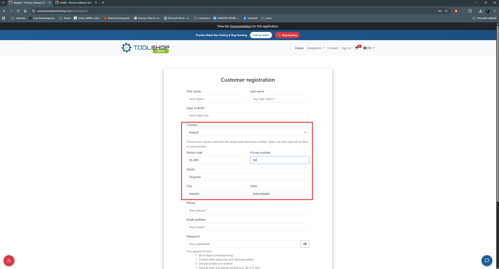
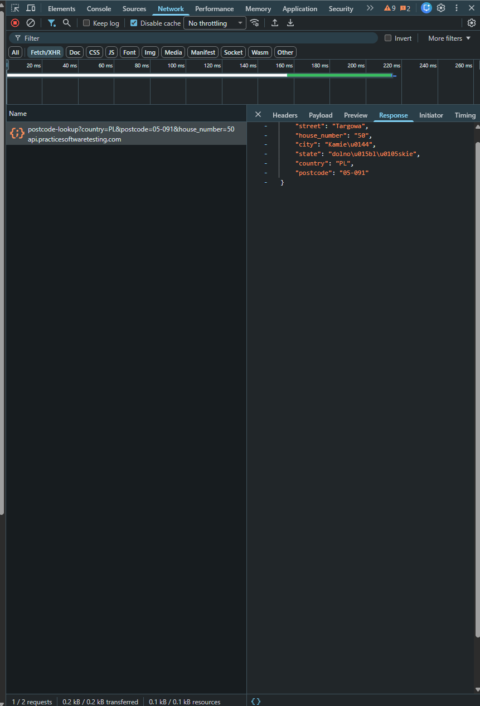

# BUG-001 — Postcode lookup returns an incorrect city and state, including impossible city–voivodeship pairs

| Field | Value |
|---|---|
| **Severity** | Minor |
| **Priority** | High |
| **Area** | Registration / Address autofill (postcode lookup API) |
| **Environment** | Chrome 156.0.8078.80, Windows 11, maximised window on a 2560x1440 display |
| **URL** | https://practicesoftwaretesting.com/auth/register |
| **API endpoint** | `GET https://api.practicesoftwaretesting.com/postcode-lookup` |
| **Reported** | 2026-11-02 |
| **Related test case** | TC-001 |

## Summary

The address autofill on the registration form returns incorrect address data. The defect
originates in the postcode lookup API, which responds successfully but with city and state
values that do not match the submitted postal code — and, for several well-known Polish
cities, with voivodeships in which those cities do not exist.

## Steps to reproduce

1. Open the registration page.
2. In the address section, select country **Poland (PL)**.
3. Enter postal code **05-091**.
4. Enter house number **22**.
5. Observe the Street, City and State fields.

## Expected result

The Street, City and State fields are filled in with the address matching the submitted
postal code and house number.

This behaviour is specified by the application itself, in the hint displayed above the
address fields, which instructs the user to choose a country and enter the postal code and
house number, after which street, city and state are filled in automatically.

For postal code 05-091 the correct values are:

| Field | Correct value |
|---|---|
| City | Ząbki |
| County | Wołomin County |
| State / Voivodeship | Mazowieckie |

Verified against an independent postal code directory:
https://postalcodes.info/postal-codes/poland/mazovia/powiat-wolominski/zabki

## Actual result

The fields are filled in automatically, but with data from an entirely different region
of the country:

| Field | Value returned |
|---|---|
| Street | Targowa |
| City | Kamień |
| State | dolnośląskie |

## API response

Request:

```
GET https://api.practicesoftwaretesting.com/postcode-lookup?country=PL&postcode=05-091&house_number=22
```

Status: `200 OK`

Response body:

```json
{
    "street": "Targowa",
    "house_number": "22",
    "city": "Kamień",
    "state": "dolnośląskie",
    "country": "PL",
    "postcode": "05-091"
}
```

The API responds successfully and the registration form renders the returned values
faithfully. **This locates the defect in the lookup service or its underlying data set,
not in the registration form.**

## Scope of the problem

The defect is not limited to a single postal code. Across several lookups, the API returned
city and voivodeship combinations that do not exist:

| City returned | Voivodeship returned | Actual voivodeship |
|---|---|---|
| Zielona Góra | śląskie | lubuskie |
| Kraśnik | śląskie | lubelskie |
| Pabianice | małopolskie | łódzkie |
| Włocławek | świętokrzyskie | kujawsko-pomorskie |

These pairings are internally inconsistent regardless of which address data set the service
uses: the cities listed are large, unambiguous Polish cities, and none of them is located in
the voivodeship returned alongside it.

This distinction matters for triage. Even if the address data set is intentionally fictitious
for demonstration purposes, a response that places Zielona Góra in śląskie or Włocławek in
świętokrzyskie is incorrect on its own terms, without reference to any external directory.

## Additional information

- **Reproducibility:** always — the response is deterministic for a given postal code
- Changing the house number for the same postal code does not change the returned city
- Repeating the same request returns identical data, so the values are not randomly
  generated; the mapping appears to be incorrect in the data set itself
- Browsers affected: Chrome and Firefox — identical response in both, confirming the defect
  is server-side and not browser-specific
- Console errors: none
- Workaround: all autofilled fields remain editable and can be corrected manually

## Impact assessment

Severity is rated **Minor** rather than Major because the incorrect values do not persist
against the user's intent:

- the autofilled fields remain editable in the registration form
- a manual correction is saved to the user profile
- the corrected address is displayed again during the purchase flow, giving the user a
  second opportunity to verify it before placing an order

Priority is rated **High** because the defect is systematic rather than data-specific: it
affects every address lookup, is immediately visible to every registering user, and concerns
a convenience feature the application explicitly advertises on screen. A user who trusts the
autofill may complete registration with an address in the wrong region, and the State field
is less prominent than Street and City, so an incorrect value there is the most likely to go
unnoticed.

## Evidence




