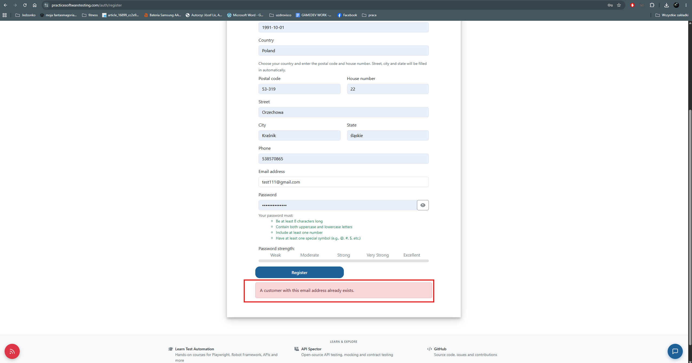
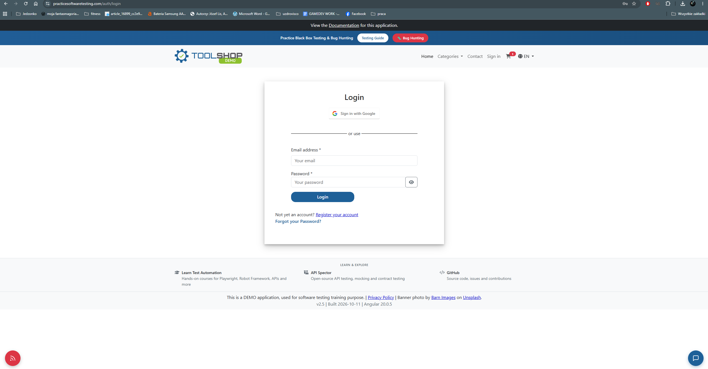

# BUG-002 — No confirmation message is displayed after a successful registration

| Field | Value |
|---|---|
| **Severity** | Minor |
| **Priority** | Medium |
| **Area** | Registration |
| **Environment** | Chrome 156.0.8078.80, Windows 11, maximised window on a 2560x1440 display |
| **URL** | https://practicesoftwaretesting.com/auth/register |
| **API endpoint** | `POST https://api.practicesoftwaretesting.com/users/register` |
| **Reported** | 2026-11-02 |
| **Related test case** | TC-001 |

## Summary

After submitting the registration form with valid data, the application redirects the user
to the login page without displaying any message. The API confirms the account was created,
but nothing on screen communicates this, so the user can only verify the outcome by
attempting to log in.

## Steps to reproduce

1. Open the registration page.
2. Fill in all required fields with valid data.
3. Submit the form.
4. Observe the screen immediately after submission.

## Expected result

A confirmation message informs the user that the account has been created successfully —
displayed either on the login page after the redirect, or before it.

The registration form itself displays feedback for unsuccessful submissions — for example,
a validation message when the e-mail address is already in use (see TC-002) — but displays
nothing when the submission succeeds. The same form therefore communicates failure while
remaining silent on success, which is inconsistent within a single flow.

The redirect to the login page itself appears intentional — registration does not
authenticate the user — so the defect is the absence of feedback, not the redirect.

## Actual result

The user is redirected to the login page with no message of any kind. The screen gives no
indication of whether the account was created, whether the submission failed, or whether the
redirect is part of the intended flow.

The account is in fact created correctly — confirmed both by the API response below and by
successfully logging in with the newly registered credentials.

## API response

Request:

```
POST https://api.practicesoftwaretesting.com/users/register
```

Status: `201 Created`

The API confirms that the account was created successfully. The information required to
display a confirmation message is therefore available to the frontend at the moment of the
redirect — it is simply not presented to the user. The defect lies in the frontend's handling
of the successful response, not in the registration logic itself.

## Additional information

- Reproducibility: always — reproduced with multiple different e-mail addresses
- Browsers affected: Chrome and Firefox
- a `GET /users/me` request returns `401 Unauthorized` after registration,
  consistent with the user not being authenticated yet — registration does not log the user
  in. No JavaScript exceptions are logged.
- Verified with 6x CPU throttling and Slow 4G network throttling: no confirmation message is
  rendered at any point between form submission and the login page
- Data integrity: not affected — the account is created and the credentials work

## Impact assessment

Severity is rated **Minor**: no data is lost and the account is created correctly, so the
defect affects confidence and usability rather than functionality.

The practical consequence appears in combination with the duplicate e-mail validation
covered by TC-002. A user who is unsure whether the registration succeeded is likely to
submit the form again, which then fails with an "e-mail already in use" message — a
confusing sequence for someone who has in fact just registered successfully, and one that
may lead them to believe the account was never created.

Priority is rated **Medium**: the fix is a single confirmation message, the data needed for
it is already returned by the API, and the defect is encountered by every new user on their
first interaction with the application.

## Evidence



*The application displays feedback for a failed submission.*



*The same flow displays nothing when the submission succeeds.*
