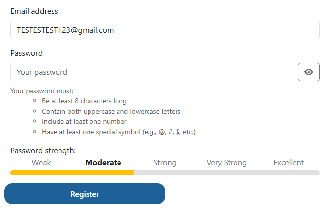
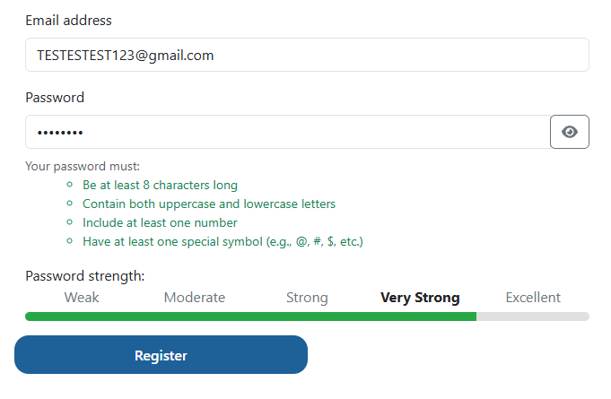

# BUG-003 — Password strength indicator updates only on focus loss, so it displays a rating for a value the field no longer contains

| Field | Value |
|---|---|
| **Severity** | Minor |
| **Priority** | Medium |
| **Area** | Registration / Password strength indicator |
| **Environment** | Chrome 156.0.8078.80, Windows 11, maximised window on a 2560x1440 display |
| **URL** | https://practicesoftwaretesting.com/auth/register |
| **Reported** | 2026-11-02 |
| **Related test case** | TC-001 |

## Summary

The password strength indicator on the registration form does not update while the user
types. It is recalculated only when the password field loses focus. As a result, the
indicator displays a rating for a value the field no longer contains — most visibly when the
field has been cleared, where it continues to show the rating of the deleted password while
the requirement checklist above it correctly shows that no requirement is met.

## Steps to reproduce

1. Open the registration page.
2. Enter a password satisfying all four stated requirements, for example at least 8
   characters with upper and lower case letters, a number and a special symbol.
   **The strength indicator does not change at this point.**
3. Click outside the password field, for example on the requirement text below it.
   **The indicator now displays a rating for the password entered.**
4. Click back into the password field and delete its entire contents.
5. Observe the requirement checklist and the strength indicator.

Repeat steps 2–5 with a short, weak password.

**Contrast case:** enter a password and delete it without clicking outside the field at any
point. The strength indicator does not change at all.

## Expected result

The strength indicator reflects the password currently entered in the field and updates as
the user types, consistently with the requirement checklist directly above it, which does
update on every keystroke.

Clearing the field resets the indicator to its empty state.

## Actual result

The indicator is recalculated only when the password field loses focus. Between focus
changes it retains whatever rating was last calculated, regardless of what the field now
contains.

With the field cleared after a focus change, the rating displayed corresponds to the
password that was deleted:

| Password entered, then deleted | Rating displayed over the empty field |
|---|---|
| Password meeting all four requirements | **Excellent** |
| Short, weak password | **Weak** |

The method of deletion does not affect the result: the behaviour occurs both when characters
are removed one by one and when the entire value is selected and deleted at once.

While the field is empty, the two parts of the same control contradict each other: the
requirement checklist shows that no requirement is satisfied, while the strength indicator
simultaneously reports a rated password.

## Observed behaviour pattern

The dependency on focus loss accounts for every observation recorded during testing,
including ones that initially appeared random:

- A password satisfying all requirements showed no rating at all — the field had not yet
  lost focus, so the indicator still reflected the empty initial state.
- A single character entered immediately after deleting a strong password showed the highest
  rating — the indicator still reflected the strong password evaluated at the previous focus
  change.
- An empty field showed a rating matching the password just deleted — again, the last value
  evaluated on focus loss.

The indicator therefore appears to be bound to a focus or blur event rather than to the
field's input event, which the requirement checklist in the same control handles correctly.

## Additional information

- Reproducibility: always, when the sequence above is followed
- Browsers affected: Chrome and Firefox — identical behaviour in both, confirming the defect
  is not browser-specific
- Console errors: none
- The requirement checklist above the indicator updates on every keystroke and resets
  correctly, so the defect is limited to the strength indicator component

## Impact assessment

Severity is rated **Minor**: the indicator is advisory, the four password requirements are
displayed and evaluated correctly, and the defect does not prevent registration or weaken
the password rules themselves.

Priority is rated **Medium** because the indicator misleads at the moment it is meant to
help. A user who clears the field and types a new password sees a rating carried over from
the previous value, so a weak password can appear strong precisely while the user is
deciding whether it is good enough. The indicator also fails to respond while typing, which
is the only time a strength meter serves any purpose.

## Evidence

*The field is empty and no requirement is marked as met, yet the indicator reports a rated password.*

*For comparison: the indicator renders a rating correctly once the field has lost focus.*
