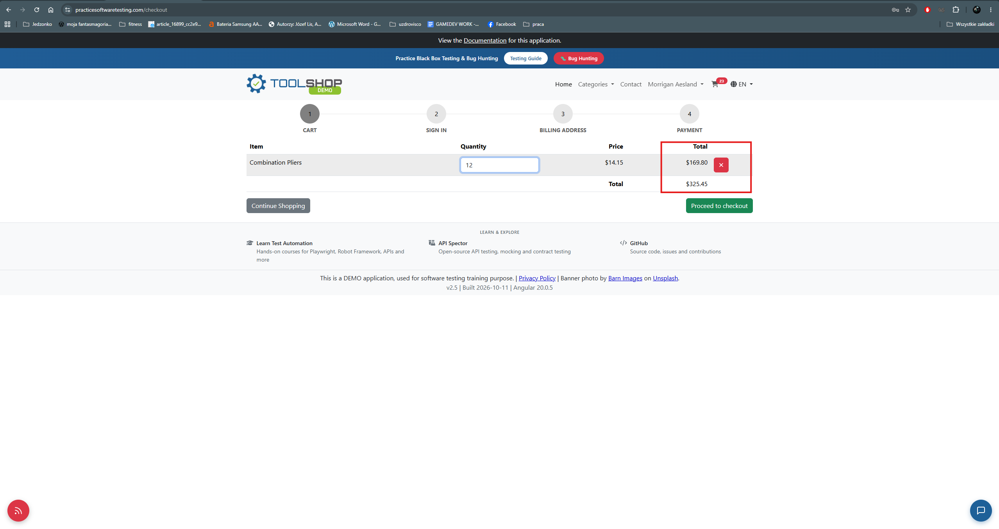
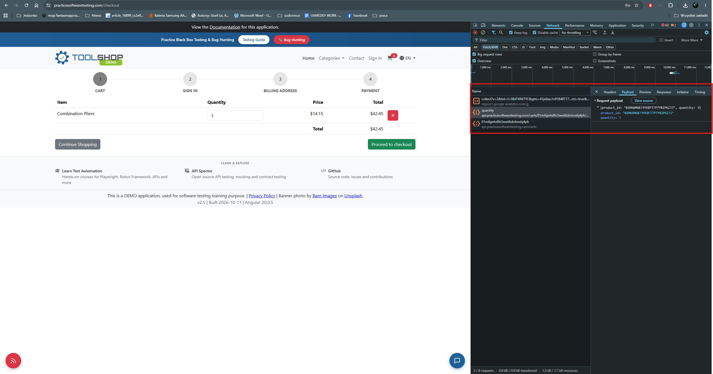

# BUG-004 — Cart line total and order total display different states until the quantity field loses focus

| Field | Value |
|---|---|
| **Severity** | Minor |
| **Priority** | Medium |
| **Area** | Cart / Quantity update |
| **Environment** | Chrome 156.0.8078.80, Windows 11, maximised window on a 2560x1440 display |
| **URL** | https://practicesoftwaretesting.com/checkout |
| **Application version** | v2.5, built 2026-10-11, Angular 20.0.5 |
| **Reported** | 2026-11-03 |
| **Related test case** | TC-031 |
| **Related defect** | BUG-003 — same update-on-focus-loss pattern in a different component |

## Summary

Changing the quantity of a product in the cart updates the line total immediately, but the
change is not sent to the server until the quantity field loses focus. Between those two
moments the line total and the order total are derived from different states: the line total
reflects the newly typed quantity, which has not been saved, while the order total reflects
the quantity actually held in the cart. The two figures contradict each other on the same
screen.

## Steps to reproduce

1. Add any product to the cart and open the cart.
2. Change the quantity of the product, for example from 1 to 3.
3. **Without clicking anywhere else**, compare the line total for that product with the
   order total.
4. Click outside the quantity field and compare the two figures again.

## Expected result

The line total and the order total are consistent with each other at all times. Either both
reflect the quantity currently entered, or neither does.

## Actual result

| Moment | Line total | Order total |
|---|---|---|
| After typing the new quantity, before leaving the field | reflects the **new** quantity | reflects the **previous** quantity |
| After the field loses focus | reflects the new quantity | reflects the new quantity |

The order total is not delayed: it is correct for the state the cart is actually in. The
line total is the misleading value, because it presents an uncommitted quantity as though it
had been applied.

## Evidence from network traffic

No request is sent while the quantity is being typed. A single request is sent when the
quantity field loses focus:

```
PUT https://api.practicesoftwaretesting.com/carts/{cartId}/product/quantity
```

Status: `200 OK`

Payload:

```json
{
  "product_id": "01M6GH2GHAF3YJT2VYM2BCJPQG",
  "quantity": 3
}
```

Response:

```json
{"result": "item added or updated"}
```

This confirms that the cart is updated server-side only on focus loss, and that the order
total shown before that point is an accurate reflection of the stored cart.

## Paths verified as correct

The uncommitted quantity does not leak into an order. Both ways of leaving the field commit
the correct value before the flow continues:

| Action after changing the quantity | Result |
|---|---|
| Pressing Enter | the request is sent with the entered quantity |
| Clicking the checkout button directly | the request is sent with the entered quantity before the flow continues |

No incorrect quantity or amount was observed in any request sent to the server.

## Additional information

- Reproducibility: always — reproduced multiple times with different quantity values
- Browsers affected: Chrome and Firefox — identical behaviour in both, confirming the defect
  is not browser-specific
- Console errors: none
- Data integrity: not affected — the committed quantity always matches what was entered

## Impact assessment

Severity is rated **Minor**: no incorrect amount reaches the server, the cart is stored
correctly, and the inconsistency resolves as soon as the field loses focus.

Priority is rated **Medium** because the inconsistency appears on the screen where the user
decides whether to buy, and concerns the figure they are most likely to check. A user who
changes a quantity and reads the order total before clicking anywhere else sees a total that
does not match the line above it, which invites doubt about whether the change was applied —
on the page where that doubt is most costly.

This is the second component in which an update is bound to focus loss rather than to input;
see BUG-003 for the same pattern in the password strength indicator on the registration
form. The two may share a cause and are worth reviewing together.

## Evidence



*Before the quantity field loses focus, the line total and the order total reflect different quantities.*



*No request is sent while typing; the cart is updated server-side only when the field loses focus.*
