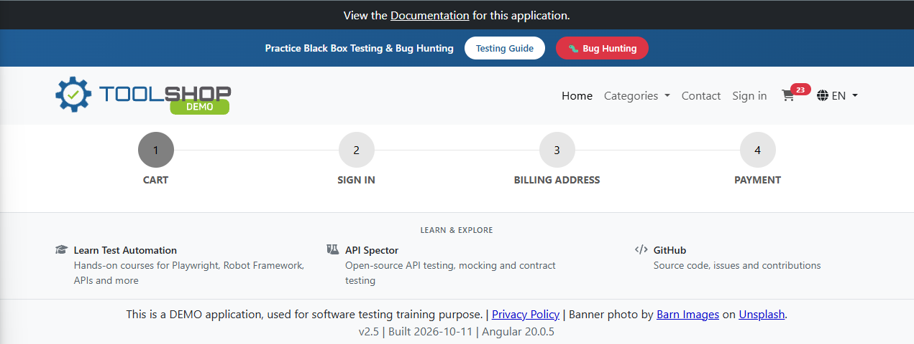
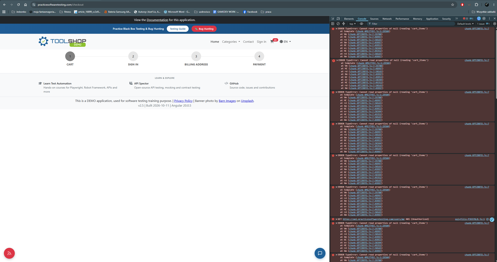
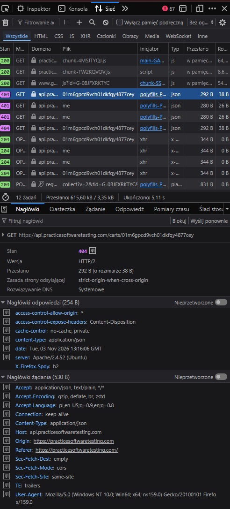

# BUG-005 — Cart page renders empty with no message after the cart expires server-side; the 404 response is not handled

| Field | Value |
|---|---|
| **Severity** | Major |
| **Priority** | High |
| **Area** | Cart / Session handling |
| **Environment** | Chrome 156.0.8078.80, Windows 11, maximised window on a 2560x1440 display |
| **URL** | https://practicesoftwaretesting.com/checkout |
| **Application version** | v2.5, built 2026-10-11, Angular 20.0.5 |
| **Reported** | 2026-11-03 |
| **Found during** | Exploratory charter 3 — checkout flow interruptions |

## Summary

After a short period of inactivity the cart expires server-side. When the user then opens the
cart, the API correctly answers `404 Not Found` for the cart the browser still holds a
reference to, but the application does not handle that response: it passes a null cart to the
template, which raises an exception and prevents the page from rendering. The user is left
with a blank cart page — no contents, no empty-cart message, no error, and no indication that
anything has happened. The cart icon continues to display the previous item count.

## Steps to reproduce

1. Add one or more products to the cart.
2. Leave the application idle. In the observed case a few minutes were sufficient.
3. Return to the application and open the cart from the header icon.
4. Observe the cart page.

The failure was first encountered while navigating back to the cart from the Sign in step of
the checkout flow; the idle period, not the navigation path, is the trigger.

## Expected result

When the cart no longer exists, the application presents an empty cart or a message
explaining that the cart has expired, and allows the user to continue shopping. A `404`
response for an expired cart is a normal, expected condition and should be handled as such.

## Actual result

The cart page renders only the step indicator and the footer. The cart contents, the totals
and any control for proceeding are absent. The application displays no message of any kind.

The cart icon in the header continues to report the previous item count, so the interface
simultaneously claims the cart holds items and fails to display them.

## Network evidence

Two requests fail when the cart page is opened after the idle period:

```
GET https://api.practicesoftwaretesting.com/carts/{cartId}
Status: 404 Not Found
```

```
GET https://api.practicesoftwaretesting.com/users/me
Status: 401 Unauthorized
```

The cart referenced by the identifier held in the browser no longer exists server-side, and
the session is no longer authorised. Both responses are correct answers to the requests made.

## Console error

```
ERROR TypeError: Cannot read properties of null (reading 'cart_items')
    at template (chunk-4MSJTYQJ.js:1:29504)
    at Vm (chunk-XPTZBBTO.js:7:39700)
    at HC (chunk-XPTZBBTO.js:7:48997)
    at rd (chunk-XPTZBBTO.js:7:50165)
    at Xm (chunk-XPTZBBTO.js:7:49997)
    at GC (chunk-XPTZBBTO.js:7:49953)
    at ev (chunk-XPTZBBTO.js:7:50344)
    at HC (chunk-XPTZBBTO.js:7:49352)
    at rd (chunk-XPTZBBTO.js:7:50165)
    at Xm (chunk-XPTZBBTO.js:7:49997)
```

The template reads `cart_items` from the cart object, which is `null` because the request for
it returned `404`. The resulting exception prevents the component from rendering.

**The defect is in the handling of the response, not in the response itself.** The API
behaves correctly; the application has no path for an expired cart.

## Recovery

| Attempt | Result |
|---|---|
| Reloading the page (F5) | Cart page still renders empty |
| Browser back button | Returns to the home page, but the cart remains broken |
| Opening the cart again from the home page | Cart page still renders empty |
| **Adding any product to the cart from a product page** | **Cart recovers and displays the newly added item** |

Recovery is possible, but only by an action the blank cart page gives no reason to attempt.
The previous cart contents are lost without notification.

## Additional information

- Reproducibility: reproduced after an idle period; a few minutes were sufficient in the
  observed case. The exact expiry interval has not been measured.
- Browsers affected: Chrome and Firefox — identical behaviour in both, confirming the defect
- The user was not logged in on either occurrence
- The cart icon count is not cleared when the cart expires, so it reports items that no
  longer exist

## Impact assessment

Severity is rated **Major**. The cart page becomes unusable and the checkout flow cannot be
continued from it, but the application is not permanently blocked: adding a new product
restores the cart. Severity is not rated Critical for that reason.

The practical impact is nonetheless significant. The trigger is ordinary user behaviour —
leaving a tab open for a few minutes is not an edge case — and the application gives the user
nothing to work with: no message, no empty state, and a header that still claims the cart has
items. The only recovery is to navigate to a product page and add something, which a user
staring at a blank cart has no reason to try. A customer in this state is likely to conclude
the site is broken and leave.

Priority is rated **High**: the defect is on the purchase path, the trigger is common, and the
fix is a null check with an empty-cart or expired-cart state for a `404` response the API
already returns correctly.

## Evidence



*The cart page has no content, while the header still reports items in the cart.*



*The template fails on a null cart object, preventing the component from rendering.*



*The cart no longer exists server-side; the application does not handle the 404.*
