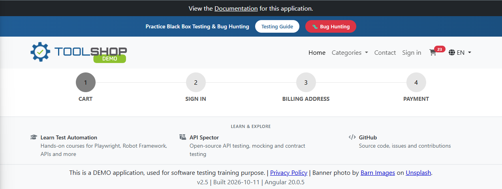
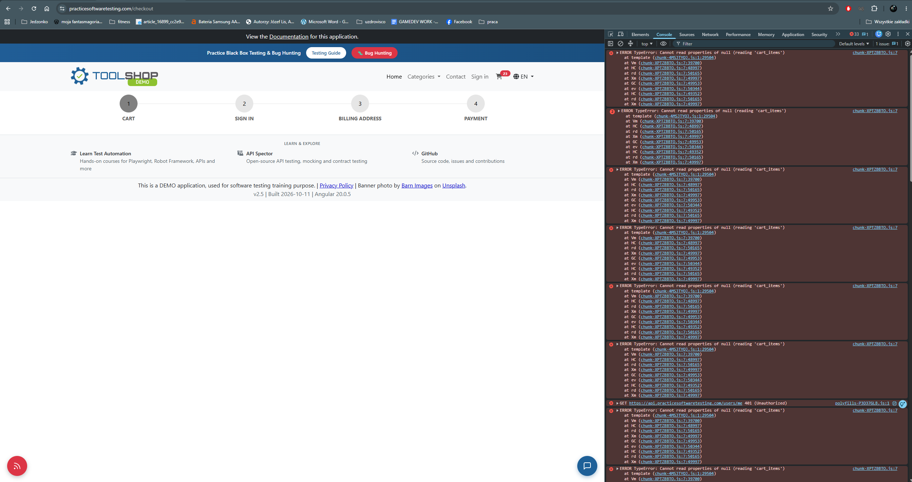

# BUG-005 — Cart page renders empty and the checkout flow becomes unusable after returning to the cart from the Sign in step

| Field | Value |
|---|---|
| **Severity** | Critical |
| **Priority** | High |
| **Area** | Cart / Checkout flow |
| **Environment** | Chrome 156.0.8078.80, Windows 11, maximised window on a 2560x1440 display |
| **URL** | https://practicesoftwaretesting.com/checkout |
| **Application version** | v2.5, built 2026-10-11, Angular 20.0.5 |
| **Reported** | 2026-11-03 |
| **Found during** | Exploratory charter 3 — checkout flow interruptions |

## Summary

While navigating back to the cart after reaching the Sign in step of the checkout flow, the
cart page stopped rendering its contents. The page displayed the step indicator and the
footer but no cart contents and no way to continue, while the cart icon still reported 23
items. The state was not recoverable: it survived a page reload and persisted when the cart
was reopened from the home page. In this state a customer can neither view their cart nor
complete a purchase by any route available in the interface.

The failure was observed once and has not been reproduced since. The console stack trace
captured at the time identifies the point of failure.

## Steps to reproduce

The failure occurred during the following sequence:

1. Add products to the cart (23 items in the cart at the time).
2. Open the cart and proceed to checkout.
3. Arrive at step 2, **Sign in**, while not logged in.
4. Navigate back to the cart by clicking the cart icon in the header.
5. Observe the cart page.

This sequence has since been repeated without reproducing the failure — see **Reproduction
attempts** below.

## Expected result

The cart page displays its contents and allows the user to continue through the checkout
flow, as it does when the cart is opened for the first time.

## Actual result

The cart page rendered only the step indicator and the footer. The cart contents, the totals
and any control for proceeding to the next step were absent. The cart icon in the header
continued to report 23 items, so the items had not been removed.

The application displayed no error message, no empty-cart message and no other indication
that something had failed. From the user's perspective the page simply had no content.

## Console error

```
ERROR TypeError: Cannot read properties of null (reading 'cart_items')
    at template (chunk-4MSJTYQJ.js:1:29504)
    at Vm (chunk-XPTZBBTO.js:7:39700)
    at HC (chunk-XPTZBBTO.js:7:48997)
    at rd (chunk-XPTZBBTO.js:7:50165)
    at Xm (chunk-XPTZBBTO.js:7:49997)
    at GC (chunk-XPTZBBTO.js:7:49953)
    at ev (chunk-XPTZBBTO.js:7:50344)
    at HC (chunk-XPTZBBTO.js:7:49352)
    at rd (chunk-XPTZBBTO.js:7:50165)
    at Xm (chunk-XPTZBBTO.js:7:49997)
```

The template attempted to read `cart_items` from an object that was `null` at the time of
rendering. The resulting exception prevented the component from rendering, which accounts
for the blank page.

## Recovery attempts

While the application was in this state, none of the routes available to a user restored the
cart:

| Attempt | Result |
|---|---|
| Reloading the page (F5) | Cart page still rendered empty |
| Browser back button | Returned to the home page, but the cart remained broken |
| Opening the cart again from the home page | Cart page still rendered empty |

The cart icon continued to report 23 items throughout, so the broken state concerned the
rendering of the cart rather than its contents.

## Reproduction attempts

The following were tried without reproducing the failure:

| Variable | Result |
|---|---|
| The same navigation sequence, logged out as in the original occurrence | Cart renders correctly |
| Changing an item quantity before proceeding to checkout | Cart renders correctly |
| Returning the cart to the same contents (23 items) | Cart renders correctly |

The conditions that trigger the failure have not been identified.

## Additional information

- Reproducibility: intermittent — observed once during exploratory testing; not reproduced
  on subsequent attempts. The console stack trace above was captured at the time of the
  failure.
- Browsers affected: observed in Chrome; not reproduced in either browser since, so no
  conclusion can be drawn about browser dependency
- The user was not logged in when the failure occurred
- Data integrity: the cart contents were not lost — the item count remained correct
  throughout

## Impact assessment

Severity is rated **Critical** on the basis of the observed state. The defect blocks the
application's primary business function: a customer who reaches this state cannot view
their cart, cannot proceed through checkout, and cannot place an order. No workaround was
available through the interface, the state persisted across page reloads, and the
application gave no indication that anything had gone wrong — so a customer would have no
reason to suspect the fault lay with the application rather than with their order.

The triggering action is not unusual. Returning to the cart from the Sign in step is an
ordinary thing for a customer to do: to check what they are buying before signing in, to
adjust a quantity, or to add one more item.

Priority is rated **High**. Although the sequence has not yet been reproduced on demand, the
stack trace identifies the failing template and the null value it reads, so the missing
guard can be located and fixed without reproducing the state first. Given that the observed
consequence is a customer unable to complete a purchase, the defect warrants investigation
even while its trigger remains unknown.

## Evidence



*The cart page has no content, while the header still reports 23 items in the cart.*



*The template failed on a null cart object, preventing the component from rendering.*
