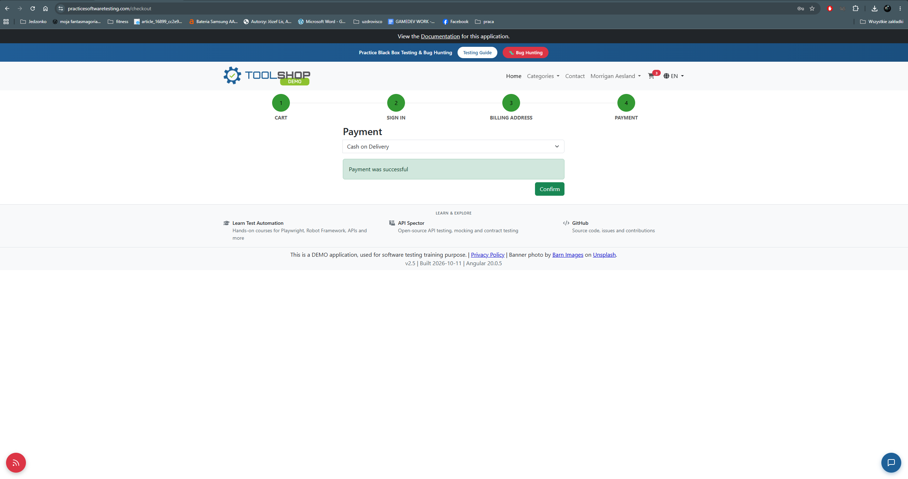
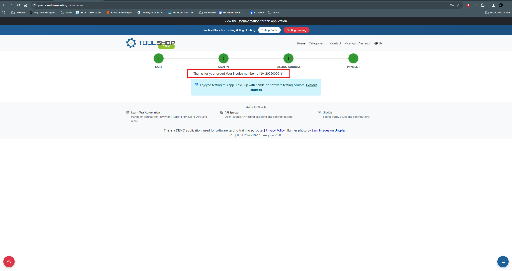

# BUG-006 — Order total is not displayed at any point after the cart step, including the payment step and the order confirmation

| Field | Value |
|---|---|
| **Severity** | Major |
| **Priority** | High |
| **Area** | Checkout flow |
| **Environment** | Chrome 156.0.8078.80, Windows 11, maximised window on a 2560x1440 display |
| **URL** | https://practicesoftwaretesting.com/checkout |
| **Application version** | v2.5, built 2026-10-11, Angular 20.0.5 |
| **Reported** | 2026-11-03 |
| **Related test case** | TC-033 |

## Summary

The amount to be paid is displayed only on step 1 of the checkout flow. It does not appear
on the Sign in, Billing address or Payment steps, and it does not appear on the order
confirmation. A customer therefore selects a payment method, confirms the order and receives
an invoice number without the application ever showing them what the order costs after they
leave the cart.

## Steps to reproduce

1. Add one or more products to the cart.
2. Open the cart and note the order total displayed on step 1.
3. Proceed through step 2 (Sign in) and step 3 (Billing address).
4. Arrive at step 4 (Payment) and select a payment method.
5. Confirm the order.
6. Observe each screen for the order total.

## Expected result

The order total is visible at the point where the customer commits to the purchase — at
minimum on the Payment step, and on the order confirmation.

The application displays the total correctly on step 1, so the value is available and the
application is able to render it. Carrying it through the remaining steps is consistent with
the application's own behaviour.

## Actual result

| Step | Order total displayed |
|---|---|
| 1 — Cart | Yes |
| 2 — Sign in | No |
| 3 — Billing address | No |
| 4 — Payment | No |
| Order confirmation | No |

The Payment step shows only a payment method selector. The order confirmation shows only
the message `Thanks for your order! Your invoice number is INV-2026000005.` Neither screen
shows an amount, an itemised summary or a link to one.

## Additional information

- Reproducibility: always 
- Browsers affected: Chrome and Firefox — identical behaviour in both, confirming the defect
- Console errors: none
- No collapsed or expandable order summary was found on the Payment step
- The amount is visible after the order is placed, in the invoice available from the user
  profile under Invoices — but not at any point before the order is confirmed

## Impact assessment

Severity is rated **Major**. The checkout flow completes and the order is placed, so nothing
is technically broken, but the customer is asked to commit to a purchase without being shown
its cost. Confirming a payment amount before paying is a basic function of a checkout flow
rather than a convenience, and it is absent from every screen on which the decision is
actually made. The amount becomes available only retrospectively, in the invoice stored in the user
profile, which does not help a customer deciding whether to place the order.

The only way to check the amount is to navigate back to step 1. That is also the navigation
that produced the unrecoverable cart state recorded in **BUG-005**, so the workaround for
this defect leads directly into the application's most severe known failure.

Priority is rated **High**: the defect is on the purchase path, affects every order, and the
value needed to fix it is already displayed one step earlier in the same flow.

## Evidence

*The customer selects a payment method without being shown the amount.*

*The confirmation gives an invoice number but no amount.*
