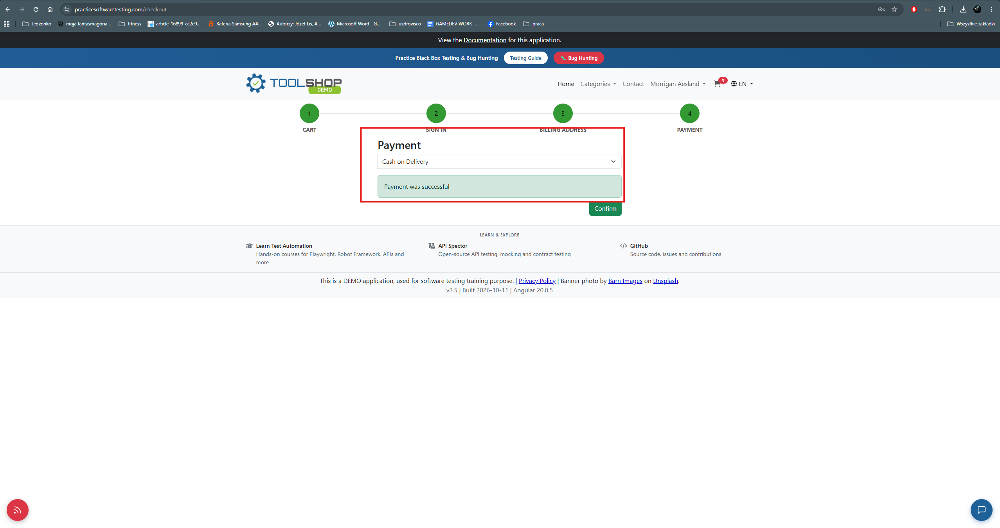

# BUG-007 — "Payment was successful" is displayed for payment methods under which no payment takes place at checkout

| Field | Value |
|---|---|
| **Severity** | Minor |
| **Priority** | Medium |
| **Area** | Checkout / Payment step |
| **Environment** | Chrome 156.0.8078.80, Windows 11, maximised window on a 2560x1440 display |
| **URL** | https://practicesoftwaretesting.com/checkout |
| **Application version** | v2.5, built 2026-10-11, Angular 20.0.5 |
| **Reported** | 2026-11-03 |
| **Related test case** | TC-033 |

## Summary

The Payment step returns the message `Payment was successful` for every payment method,
including **Cash on Delivery** and **Buy Now Pay Later** — two methods under which, by
definition, no payment is made at the time of ordering. In both cases the customer still
owes the full amount, but the application tells them their payment has succeeded.

## Steps to reproduce

1. Add a product to the cart and proceed through the checkout flow to step 4, **Payment**.
2. Select **Cash on Delivery** from the payment method list.
3. Click **Check payment**.
4. Observe the message displayed.

Repeat with **Buy Now Pay Later**.

## Expected result

The message reflects what has actually happened for the method chosen. For Cash on Delivery,
a confirmation that the order will be paid on delivery; for Buy Now Pay Later, a confirmation
that payment has been deferred. Neither should be described as a completed payment.

## Actual result

The same message, `Payment was successful`, is displayed for every method:

| Payment method | Payment details required | Message displayed |
|---|---|---|
| Cash on Delivery | no | `Payment was successful` |
| Buy Now Pay Later | no | `Payment was successful` |
| Bank Transfer | yes | `Payment was successful` |
| Credit Card | yes | `Payment was successful` |
| Gift Card | yes | `Payment was successful` |

For Cash on Delivery and Buy Now Pay Later, no payment has been made and none could have
been: no payment details are collected and no funds are transferred. The customer owes the
full amount at delivery or at a later date, while the application reports the payment as
complete.

## Behaviour verified as correct

Input validation on the payment step works as expected and is not part of this defect:

| Check | Result |
|---|---|
| Credit Card, Bank Transfer and Gift Card with empty fields | the **Check payment** button is disabled |
| The order confirmation reached after clicking Confirm | displays `Thanks for your order!` with an invoice number — no incorrect payment claim |

The incorrect message is therefore confined to the Payment step itself.

## Additional information

- Reproducibility: always — reproduced for all five payment methods
- Browsers affected: Chrome and Firefox — identical behaviour in both, confirming the defect
- Console errors: none
- The message appears to be hard-coded for the payment step rather than derived from the
  selected method, since it is identical across methods with entirely different payment
  semantics

## Impact assessment

Severity is rated **Minor**: the order is placed correctly, no funds are affected, and the
subsequent order confirmation does not repeat the incorrect claim.

Priority is rated **Medium** because the message is misleading on a financial matter. A
customer choosing Cash on Delivery who is told their payment was successful may reasonably
believe the order is paid for and be unprepared to pay the courier. The same applies to Buy
Now Pay Later, where the customer is told a payment succeeded at the moment they chose to
defer it.

This also compounds **BUG-006**: the customer is never shown the amount after the cart step,
and is then told that a payment they never made has succeeded. Taken together, the Payment
step gives a customer no accurate information about what they owe or whether they have paid
it.

## Evidence

*No payment is taken for Cash on Delivery, yet the application reports a successful payment.*
