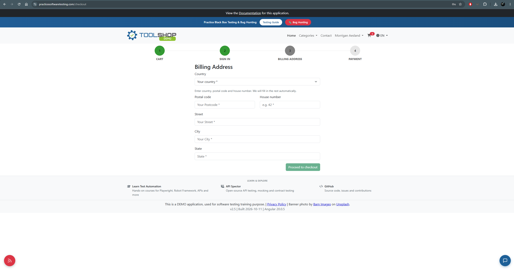
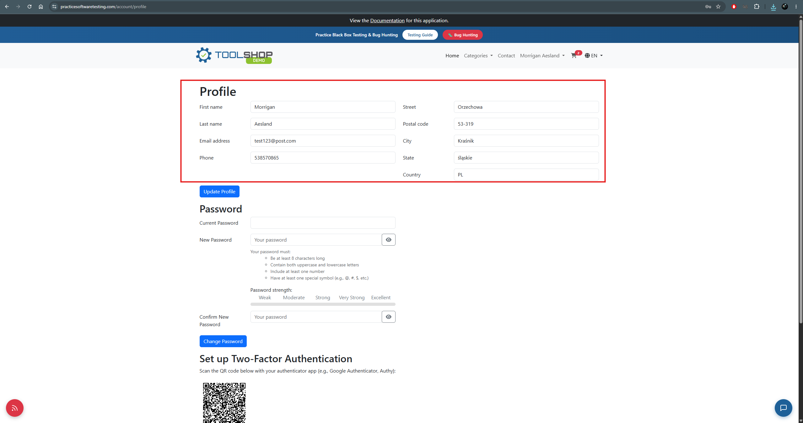

# BUG-008 — Billing address is not prefilled from the saved profile address and is not retained between orders

| Field                   | Value                                                                     |
| ----------------------- | ------------------------------------------------------------------------- |
| **Severity**            | Minor                                                                     |
| **Priority**            | Medium                                                                    |
| **Area**                | Checkout / Billing address                                                |
| **Environment**         | Chrome 156.0.8078.80, Windows 11, maximised window on a 2560x1440 display |
| **URL**                 | https://practicesoftwaretesting.com/checkout                              |
| **Application version** | v2.5, built 2026-10-11, Angular 20.0.5                                    |
| **Reported**            | 2026-11-03                                                                |
| **Related test case**   | TC-033                                                                    |
| **Related defect**      | BUG-001 — the same postcode lookup is used on this step                   |

## Summary

Step 3 of the checkout flow, **Billing Address**, presents every field empty for a user who
is logged in and has a complete address saved on their profile. The application collects
exactly these fields during registration and displays them in the user profile, but does not
offer them here — there is no prefilled value and no option to reuse the saved address. The
address entered at checkout is also not retained: a subsequent order requires the full
address to be typed again.

## Steps to reproduce

1. Register an account with a complete address, or sign in to an account that already has one.
2. Confirm the address is present on the user profile.
3. Add a product to the cart and proceed through the checkout flow to step 3, **Billing
   Address**.
4. Observe the form.
5. Complete the order, then place a second order and return to step 3.

## Expected result

The billing address fields are prefilled with the address saved on the user's profile, with
the option to change them for this order.

The application collects country, postal code, house number, street, city and state during
registration, stores them and displays them in the profile. The same six fields are requested
again here. Reusing stored data the application already has is consistent with it having
collected and retained that data in the first place.

If the billing address is intended to be separate from the profile address, the step would
still be expected to offer the saved address as an option, and to retain the address entered
for use on subsequent orders.

## Actual result

All fields on the Billing Address step are empty, showing only placeholder text (`Your
country *`, `Your Postcode *`, `e.g. 42 *`, `Your Street *`, `Your City *`, `State *`). The
header confirms the user is signed in.

No control is offered for reusing the saved address — no checkbox, link or preset.

The address entered is not saved back to the profile and is not reused: a second order placed
on the same account presented the same empty form, requiring the full address to be entered
again.

No request for the user's stored address is made when the step loads, so the empty form is
not the result of a failed lookup — the saved address is never requested.

## Additional information

- Reproducibility: always — confirmed across two consecutive orders on the same account
- Browsers affected: Chrome and Firefox — identical response in both, confirming the defect
- Console errors: none
- No request for profile or address data is made when the Billing Address step loads, so
  the application does not attempt to retrieve the saved address at all

## Relationship to BUG-001

This step uses the same postcode lookup as the registration form, shown by the same hint text
above the fields: entering a country, postal code and house number is expected to fill in the
remaining fields automatically. That lookup returns incorrect city and state values here in
the same way it does on the registration form (**BUG-001**), confirmed during this testing.

The two defects compound. Because the saved address is not reused, the customer is required
to enter their address again on every order, and the autofill offered to help them do so
returns an address from the wrong region — so the manual correction has to be repeated each
time as well.

## Impact assessment

Severity is rated **Minor**: the checkout flow can be completed, the data entered is accepted,
and nothing is lost.

Priority is rated **Medium**. Re-entering an address on every order is friction at the point
of purchase, which is where friction is most expensive, and it undoes the value of having
collected the address at registration. The friction is compounded by BUG-001, since the
autofill intended to reduce it produces incorrect data that the customer must then correct by
hand — on every order.

## Evidence

_The user is signed in and has a saved address, yet every field is empty._

_The same address fields are stored on the profile._
