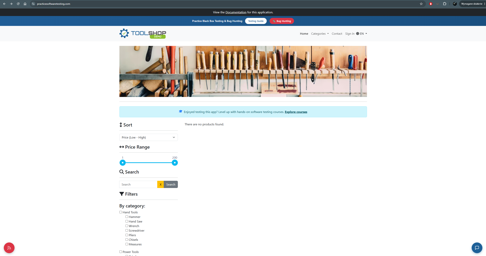

# BUG-009 — Product list renders as empty at the full price range after the API returns null for the product collection

| Field | Value |
|---|---|
| **Severity** | Minor |
| **Priority** | Medium |
| **Area** | Product catalogue / Price range filter |
| **Environment** | Chrome 156.0.8078.80, Windows 11, maximised window on a 2560x1440 display |
| **URL** | https://practicesoftwaretesting.com/ |
| **Application version** | v2.5, built 2026-10-11, Angular 20.0.5 |
| **Reported** | 2026-11-04 |
| **Found during** | Exploratory charter 1 — price range filter |
| **Related defect** | BUG-005 — the same null-instead-of-collection pattern in the cart API |

## Summary

While adjusting the price range filter on the home page, the product list rendered as
`There are no products found.` with the slider set to its full range, 1–200. At the full
range every product in the shop should be listed. The API response at that moment contained
`null` in place of the product collection.

The condition was not reproduced afterwards.

## Steps to reproduce

The failure occurred during the following sequence:

1. Open the home page.
2. Adjust the price range slider, moving the upper handle to its maximum value of 200.
3. Observe the product list.

At that point the list displayed `There are no products found.` while the slider showed the
full range 1–200.

This sequence has since been repeated without reproducing the failure — see **Reproduction
attempts** below.

## Expected result

With the price range set to its full extent, every product in the shop is listed. No filter
setting that spans the entire price range should exclude all products.

## Actual result

The product area displayed `There are no products found.` with the slider at 1–200. The
category and sorting controls remained populated and functional, so the page itself had
loaded correctly — only the product list was empty.

Any subsequent movement of the slider restored the product list.

## Network evidence

The response received at the time of the failure contained `null` in place of the product
collection, rather than an empty list or a populated one.

The frontend rendered its empty-state message in response, so the displayed result is
consistent with the data it received. The anomaly is in the response itself.

## Reproduction attempts

The following were tried without reproducing the failure:

| Variable | Result |
|---|---|
| Setting the slider to the full range again, in a single movement | All products listed correctly |
| Dragging the slider rapidly back and forth across the range | All products listed correctly; requests and responses matched the selected range |
| Repeating the sequence several times | All products listed correctly |

No pattern in request ordering or response timing was observed during these attempts. The
conditions that produce the null response have not been identified.

## Related instability on the same endpoint

Later in the same session the products endpoint returned a server error, with some requests
left pending:

```
QUERY https://api.practicesoftwaretesting.com/products
Status: 500 Internal Server Error
```

Response body:

```json
{"message": "Something went wrong"}
```

The condition cleared after a page reload and did not recur. It is recorded here rather than
as a separate defect: a single server error on a shared demonstration environment does not
distinguish an application fault from environment instability. It is noted because it may be
the same underlying condition that produced the null response above — both affect the same
endpoint and both resolve without intervention.

## Additional information

- Reproducibility: intermittent — observed once during exploratory testing, not reproduced
  since
- Browsers affected: observed in Chrome; not reproduced in either browser since
- Console errors: none
- The page remained otherwise functional throughout: filters, sorting and navigation all
  worked

## Relationship to BUG-005

This is the second occasion on which the API returned `null` where the application expected a
collection. In **BUG-005** the cart endpoint produced a state in which `cart_items` was read
from a null object, crashing the template.

The handling differs between the two cases: here the frontend degraded gracefully and showed
its empty state, while in BUG-005 it raised an exception and rendered nothing. The underlying
pattern — a null value where a collection belongs — is worth reviewing across the API rather
than only at the two points where it has been observed.

## Impact assessment

Severity is rated **Minor**: the condition is transient, the page remains functional, and any
further interaction with the filter restores the product list. No data is lost or
misrepresented.

Priority is rated **Medium** despite the low severity, because of what the customer sees. A
shop that reports having no products at all, on its home page, at a filter setting that
excludes nothing, gives a customer every reason to leave — and no reason to move the slider
again to find out it was wrong. The visible symptom is more severe than the underlying fault.

## Evidence



*The slider spans the full price range, yet no products are listed.*
