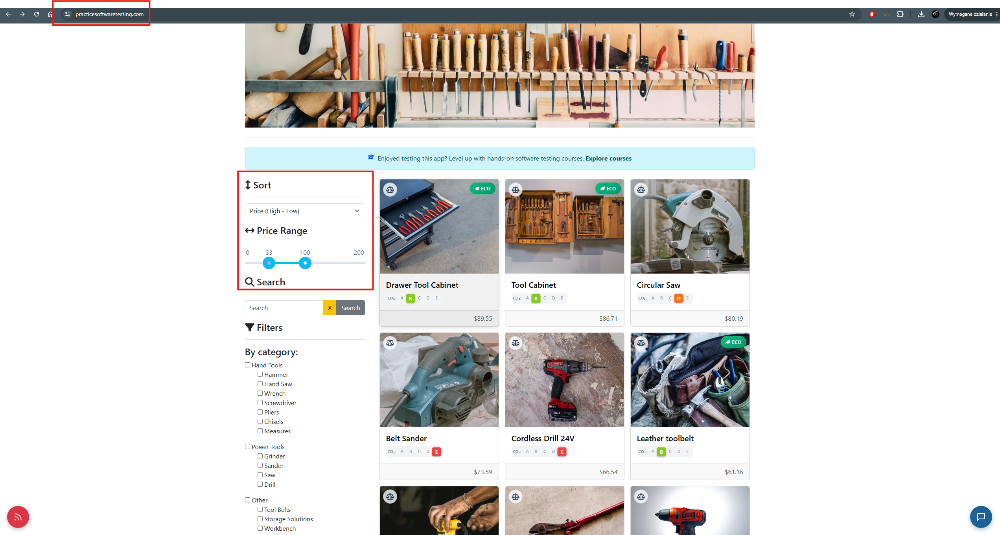

# BUG-010 — Filter and sort selections are not reflected in the URL and are lost on page reload and browser navigation

| Field | Value |
|---|---|
| **Severity** | Minor |
| **Priority** | Medium |
| **Area** | Product catalogue / Filtering and sorting |
| **Environment** | Chrome 156.0.8078.80, Windows 11, maximised window on a 2560x1440 display |
| **URL** | https://practicesoftwaretesting.com/ |
| **Application version** | v2.5, built 2026-10-11, Angular 20.0.5 |
| **Reported** | 2026-11-04 |
| **Found during** | Exploratory charter 1 — price range filter |

## Summary

Selecting a price range, a sort order, a category or a brand does not change the page URL.
The selection is held only in the component's state, so it survives moving between pages of
results but is lost whenever the page is actually loaded again — on a browser reload, and on
returning from a product page with the back button. A customer browsing a filtered catalogue
has to reapply their filter every time they look at a product and come back.

## Steps to reproduce

1. Open the home page.
2. Set a price range and a sort order, and note that the product list updates accordingly.
3. Observe the address bar.
4. Reload the page (F5).
5. Reapply the filter, open any product, then return using the browser back button.

## Expected result

The filter and sort selections are reflected in the URL, so that they survive a page reload
and browser navigation, and so that a filtered view can be bookmarked or shared.

## Actual result

The address bar does not change when any filter or sort option is selected — no query
parameters are added.

| Action | Filter and sort state |
|---|---|
| Moving to another page of results | **Preserved** |
| Reloading the page (F5) | Lost — the catalogue returns to its default, unfiltered state |
| Opening a product and returning with the browser back button | Lost |

Moving between pages of results preserves the selection, which shows the application does
hold the state correctly while the view is alive. It is not written anywhere that survives
the view being recreated.

## Additional information

- Reproducibility: always
- Confirmed for all catalogue controls: price range, sort order, category filters and brand
  filters
- Browsers affected: Chrome and Firefox — identical behaviour in both
- Console errors: none

## Impact assessment

Severity is rated **Minor**: the filters themselves work, nothing is lost beyond the
selection, and reapplying it takes a few seconds.

Priority is rated **Medium** because of how the loss is triggered. Browsing a filtered
catalogue consists of opening a product, going back, and opening the next one — so the
selection is lost at precisely the point in the journey where it is being used. A customer
who narrows the catalogue down to a handful of products and then opens one of them returns to
the full, unfiltered list, and has to narrow it down again for every product they want to look
at.

A secondary consequence is that a filtered or sorted view cannot be bookmarked or shared,
since every URL in the catalogue describes the same default view.

## Evidence

*The product list is filtered and sorted, while the address bar shows the plain home page URL.*
